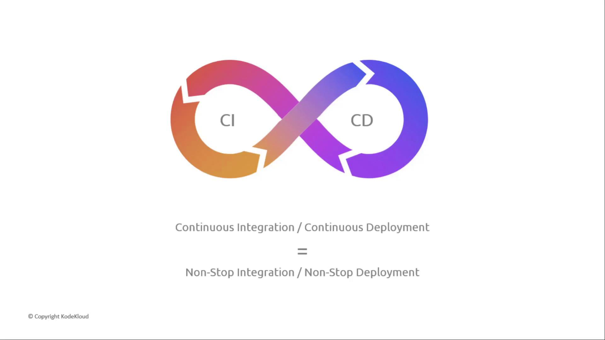
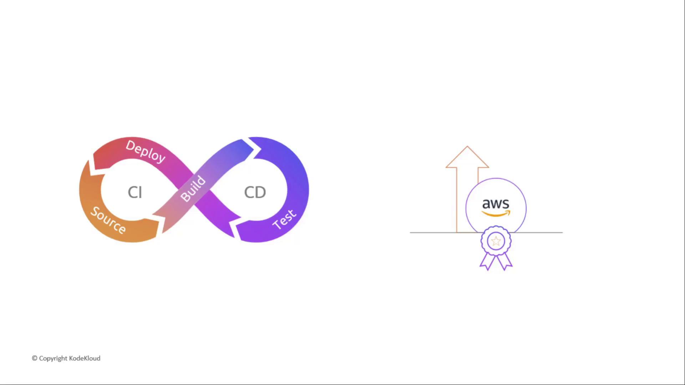
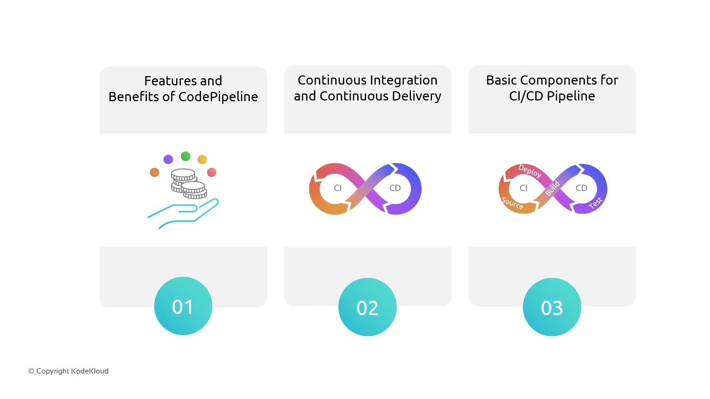
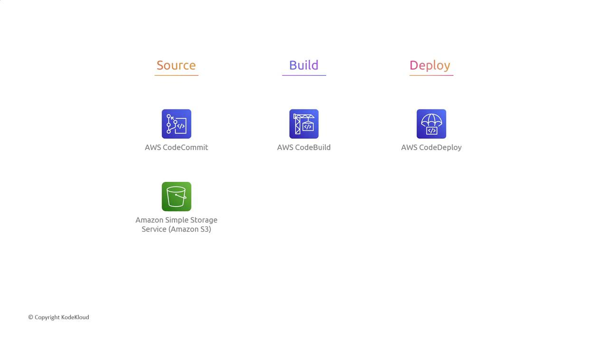
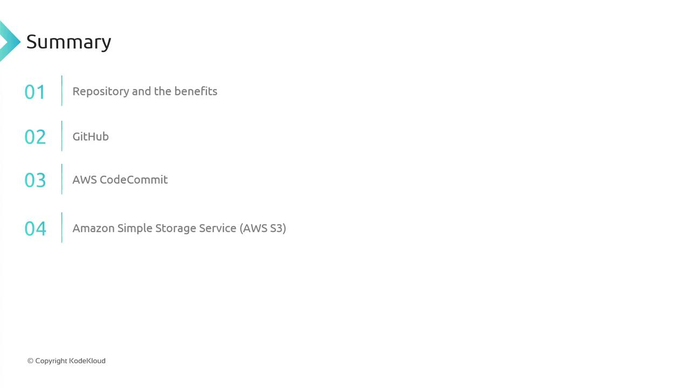
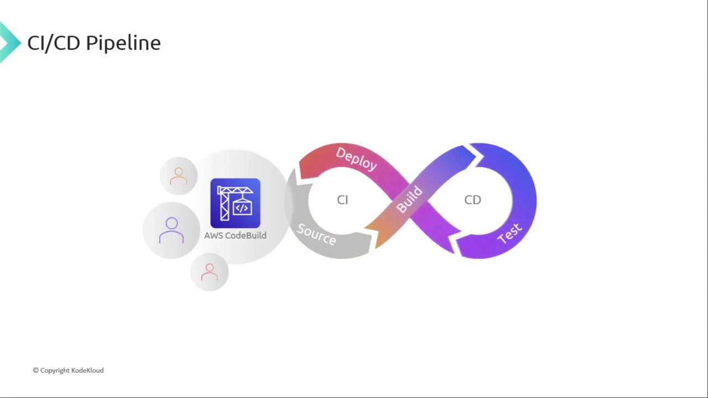
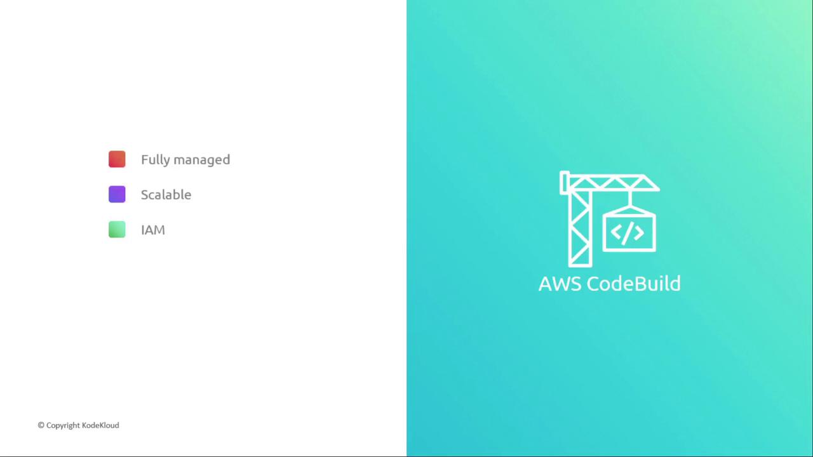
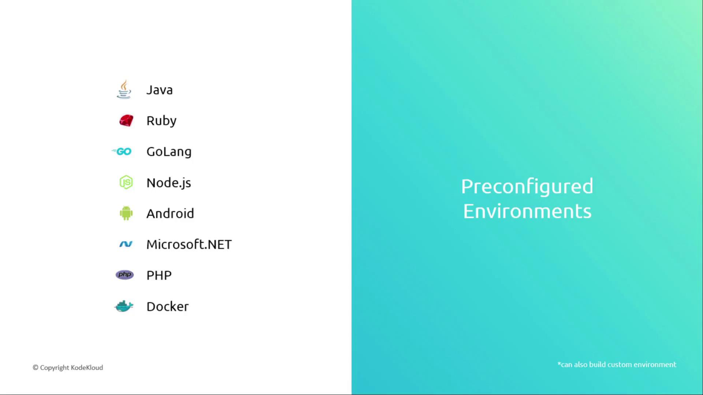
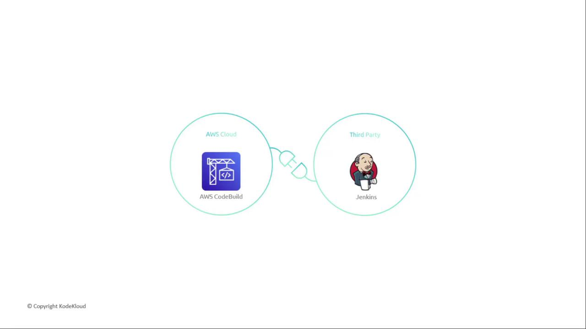
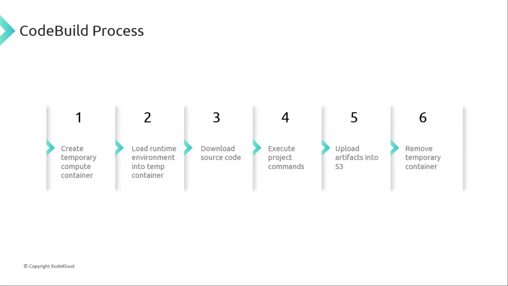

# 01 — CI/CD and the AWS Code* services

**Learning objectives**

- Explain **CI** and **CD** in plain words
- Match each AWS service to a pipeline stage
- Know what `buildspec.yml` tells CodeBuild to do

> Console diagrams in this lesson are stored under [`../images/day-08-cicd/`](../images/day-08-cicd/) (from [KodeKloud AWS CodePipeline](https://notes.kodekloud.com/docs/AWS-CodePipeline-CICD-Pipeline)).

---

## One-sentence idea

CI/CD is a **conveyor belt** that takes your code from commit to running app, automatically.



---

## CI and CD in plain words

- **CI — Continuous Integration:** every time someone pushes code, it's automatically **built and tested**. Catch breakage early.
- **CD — Continuous Delivery/Deployment:** the tested build is automatically **deployed** to servers.

```text
Commit ─▶ Build & test (CI) ─▶ Deploy (CD) ─▶ Running app
```



No more "it worked on my machine" and no manual copy-to-server at 2am.

---

## What is AWS CodePipeline?

**CodePipeline** is the fully managed service that **orchestrates** that conveyor belt. On every change it moves artifacts through stages; when one stage succeeds, the next starts.



| Stage | Purpose | Example tools |
| ----- | ------- | ------------- |
| **Source** | Grab code when it changes | GitHub, S3, CodeCommit (legacy) |
| **Build** | Compile, test, package | CodeBuild, Jenkins |
| **Test** | Extra checks (optional stage) | CodeBuild, Device Farm |
| **Deploy** | Release to the target | CodeDeploy, S3, ECS, Lambda |



---

## The AWS Code* family

| Service | Job | Analogy |
| ------- | --- | ------- |
| **CodeCommit** | Git hosting (legacy; use **GitHub** now) | The warehouse of code |
| **CodeBuild** | Compile, test, package | The factory machine |
| **CodeDeploy** | Push the build to EC2/ECS/Lambda | The delivery van |
| **CodePipeline** | Orchestrate all the stages | The conveyor belt tying it together |

> Think of **CodePipeline** as the manager that calls CodeBuild, then CodeDeploy, in order, on every change.



> **Note:** AWS CodeCommit is closed to new accounts — this course uses **GitHub** as the source (same idea: a Git repo that triggers the pipeline).



---

## CodeBuild in one slide

CodeBuild is **serverless CI**: no build servers to patch. It spins up a container, runs your commands, uploads artifacts, then tears the container down.





| Aspect | CodeBuild | Jenkins |
| ------ | --------- | ------- |
| Hosting | Fully managed by AWS | You run the servers/agents |
| Scaling | Automatic parallel builds | Scale workers yourself |
| Security | IAM + KMS | Plugins / custom setup |



---

## buildspec.yml — CodeBuild's instructions

CodeBuild reads a `buildspec.yml` from your repo:

```yaml
version: 0.2
phases:
  install:
    commands: [ "echo installing" ]
  build:
    commands: [ "echo building", "npm test" ]
artifacts:
  files: [ "**/*" ]
```

- **phases** run in order: install → pre_build → build → post_build.
- **artifacts** are the output files handed to the next stage.



---

## Knowledge check

1. What's the difference between CI and CD?
2. Which service orchestrates the whole flow?
3. Where do you put the commands CodeBuild should run?

<details>
<summary>Answers</summary>

1. CI automatically builds and tests every change; CD automatically deploys the tested build.
2. CodePipeline — it ties source, build (CodeBuild), and deploy (CodeDeploy) together.
3. In `buildspec.yml` at the repo root (phases + artifacts).

</details>

➡️ Next: [03 — CodeBuild demo](./03-CodeBuild-Demo.md)
