# 02 — Pipelines and deployments

**Learning objectives**

- Understand a **CodePipeline** as linked stages
- Know what **CodeDeploy** and `appspec.yml` do
- Compare **in-place**, **rolling**, **immutable**, and **blue/green** deployments

> Screenshots and diagrams: [`../images/day-08-cicd/`](../images/day-08-cicd/) (KodeKloud AWS CodePipeline notes).

---

## One-sentence idea

A pipeline watches your repo and, on every change, runs **Source → Build → Deploy** with no human in the loop.

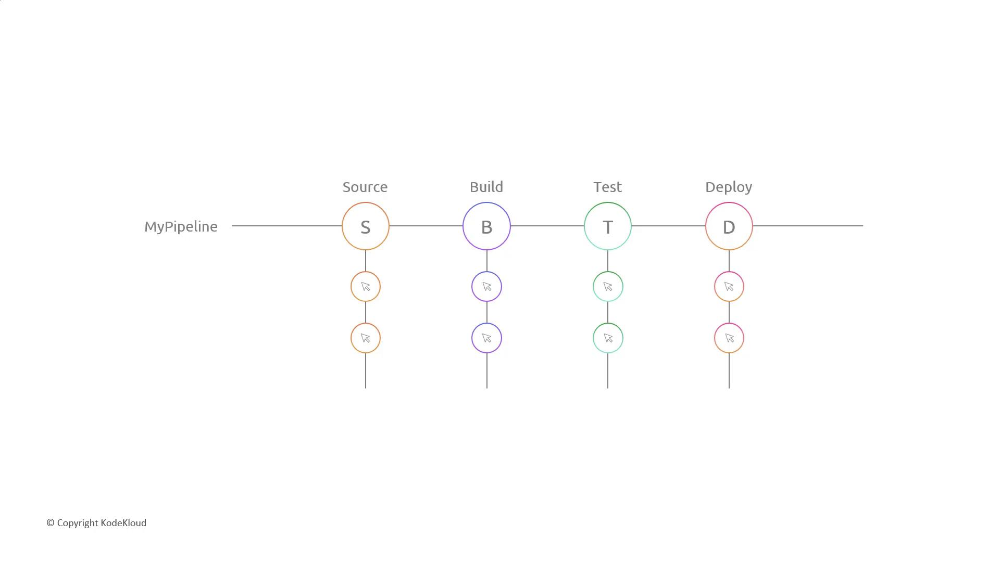

---

## Pipeline stages

```text
┌─ Source ─┐   ┌─ Build ──┐   ┌─ Deploy ──┐
│ GitHub   │─▶ │ CodeBuild│─▶ │ CodeDeploy│─▶ EC2 / S3 / ECS
└──────────┘   └──────────┘   └───────────┘
```

- **Source:** triggers on each commit; grabs the code.
- **Build:** CodeBuild runs `buildspec.yml`, produces artifacts.
- **Deploy:** CodeDeploy (or S3/ECS) pushes the artifacts to the target.

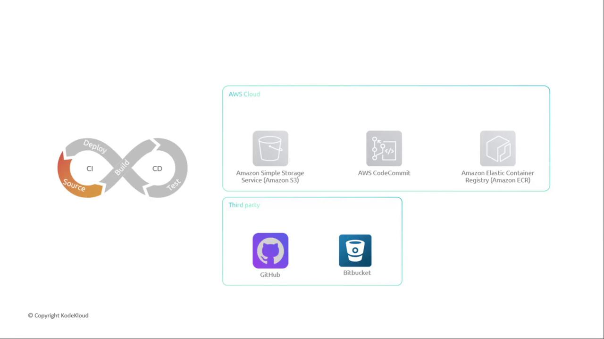

Each stage passes **artifacts** to the next. If any stage fails, the pipeline stops — bad code doesn't reach production.

You can also insert a **manual approval** (SNS notification) before production, or invoke Lambda for custom checks.

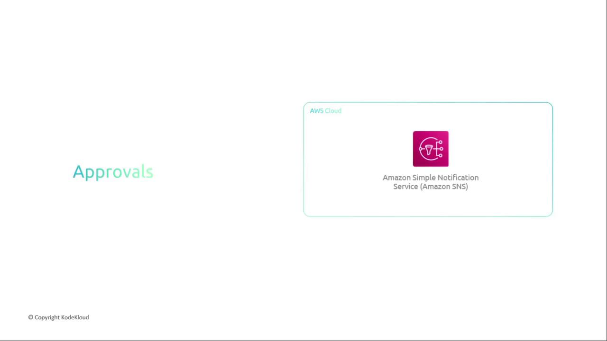

---

## CodeDeploy — the delivery van

CodeDeploy pushes a revision to:

- Amazon **EC2** / on-premises servers
- **AWS Lambda**
- **Amazon ECS** / Fargate

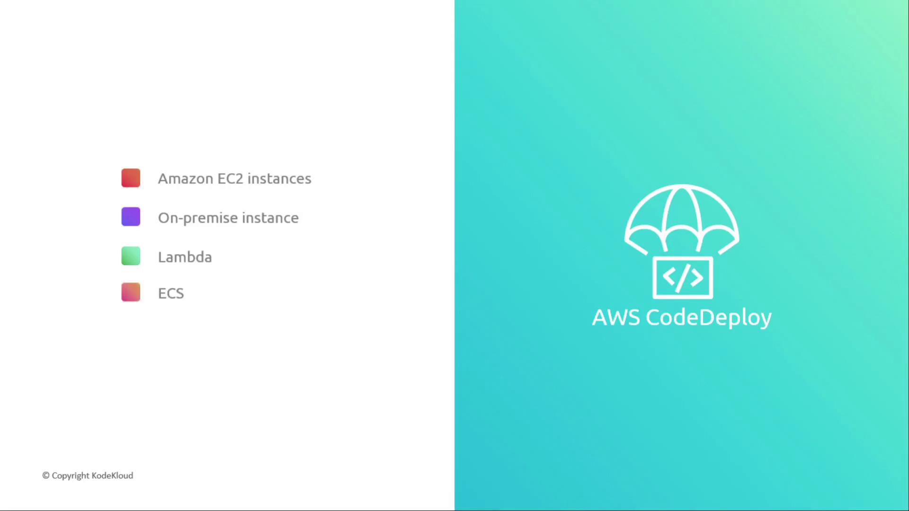

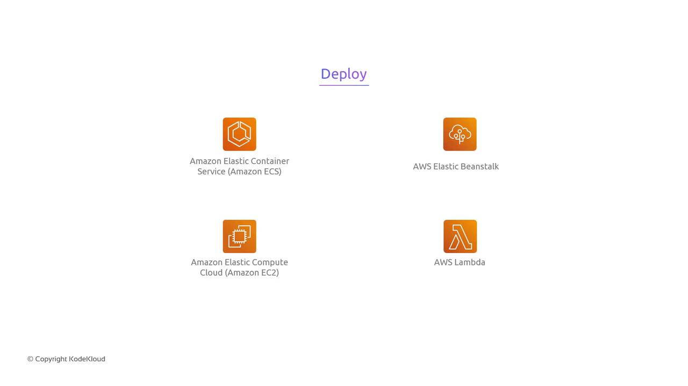

---

## CodeDeploy and appspec.yml

CodeDeploy needs an `appspec.yml` that answers:

- **Where do files go?** (`files:` → destination paths)
- **What scripts run, and when?** (`hooks:` → lifecycle events)

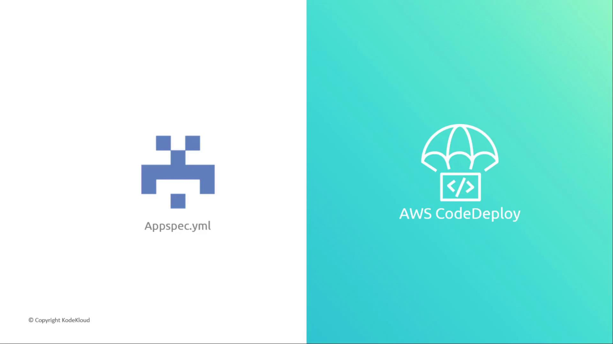

```yaml
version: 0.0
os: linux
files:
  - source: index.html
    destination: /var/www/html/
hooks:
  AfterInstall:
    - location: scripts/restart_server.sh
```

Lifecycle hooks (`BeforeInstall`, `AfterInstall`, `ApplicationStart`, …) let you stop/start services around the copy. The **CodeDeploy agent** on the instance runs those hooks.

---

## Deployment strategies

| Strategy | How | Benefit |
| -------- | --- | ------- |
| **In-place** | Update the same servers | Simple |
| **Rolling** | Update a batch at a time | Gradual validation |
| **Immutable** | New instances, then cut over | Clean slate each release |
| **Blue/Green** | Launch new set, switch traffic, keep old as fallback | **Zero-downtime**, easy rollback |

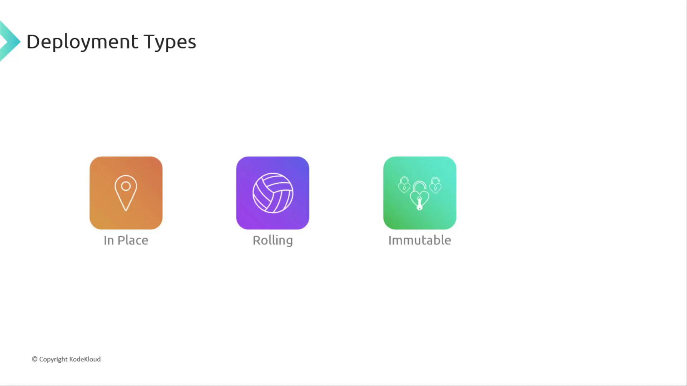

### Blue/Green (the gold standard)

- **Blue** = current production
- **Green** = new version standing by

Validate green, then shift traffic. If green is broken, flip back to blue instantly.

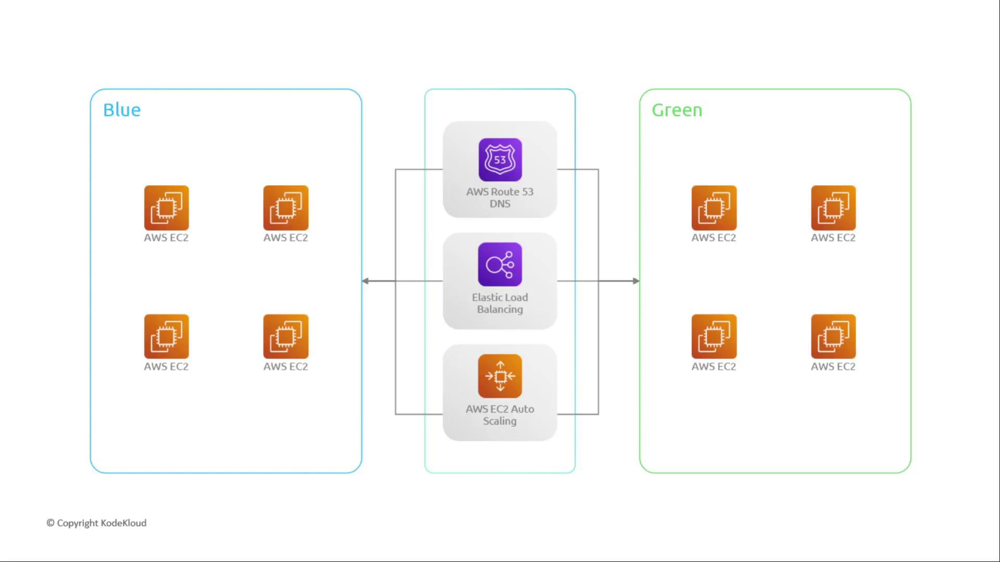

Traffic can shift as **canary** (small %), **linear** (steps), or **all-at-once**.

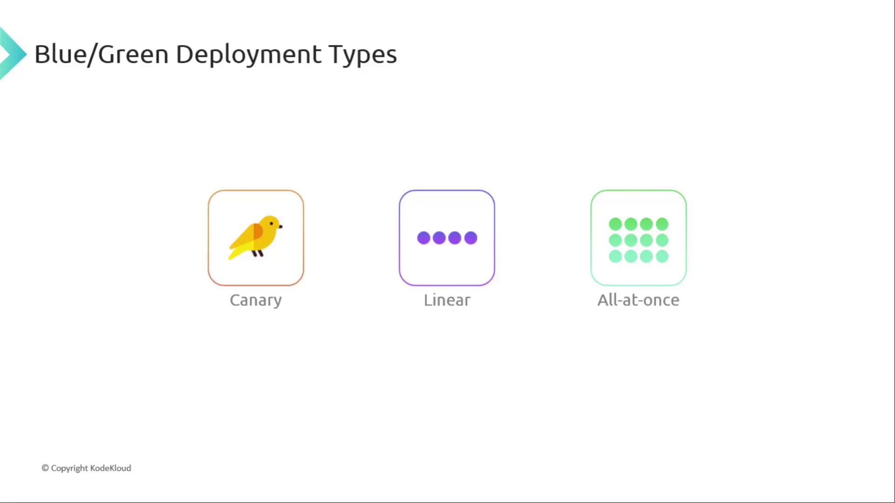

---

## Pipeline shapes you'll see in demos

KodeKloud walks three patterns — same idea, more stages:

| Pattern | Stages | Good for |
| ------- | ------ | -------- |
| Minimal | Source → Deploy | Artifact already built (ZIP in S3) |
| Git → Deploy | Source (Git) → Deploy | Skip build for static apps |
| Full CI/CD | Source → Build → Test → Deploy | Real apps with compile + tests |

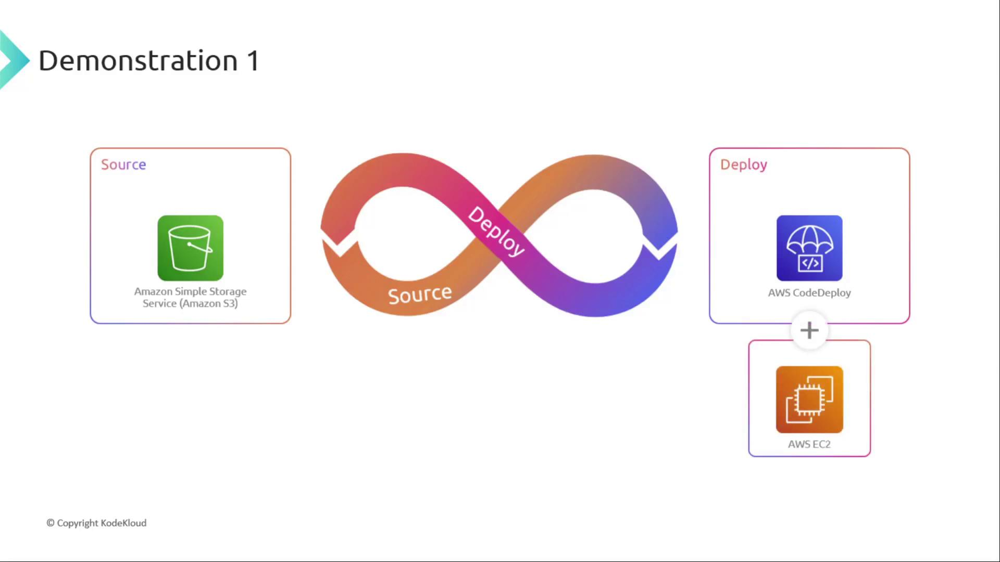

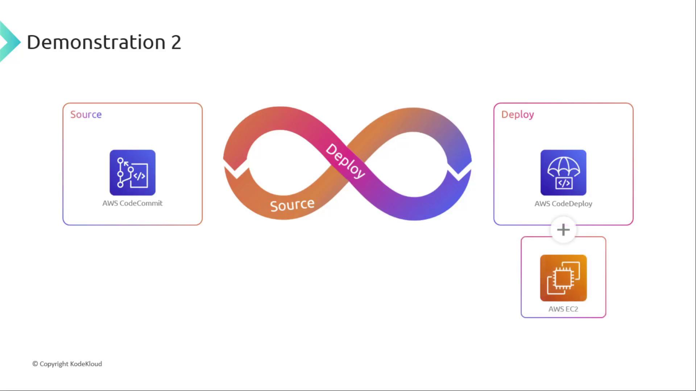

This course's labs use **GitHub → CodeBuild → S3** (cheap, no EC2) — same conveyor belt, simpler deploy target.

---

## Knowledge check

1. What happens to the pipeline if the Build stage fails?
2. What two questions does `appspec.yml` answer?
3. Why prefer blue/green over in-place for production?

<details>
<summary>Answers</summary>

1. It stops — the Deploy stage never runs, so broken code isn't released.
2. Where files should be copied, and which scripts (hooks) run at each lifecycle event.
3. Zero downtime and instant rollback by switching traffic back to the old environment.

</details>

➡️ Next: [04 — CodePipeline demo](./04-CodePipeline-Demo.md)
