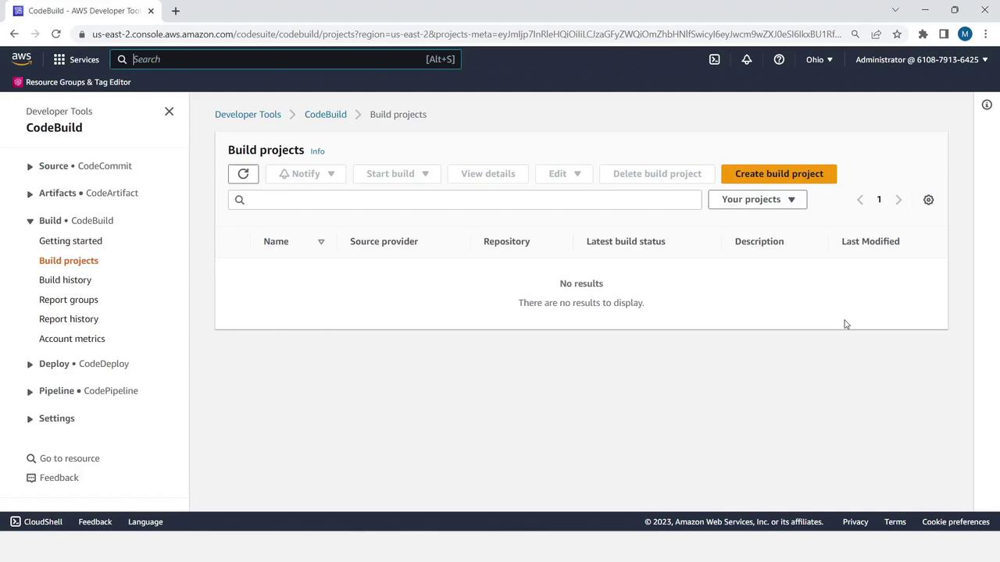
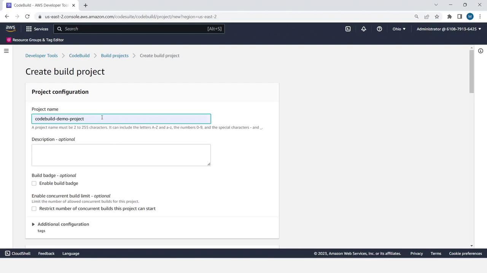
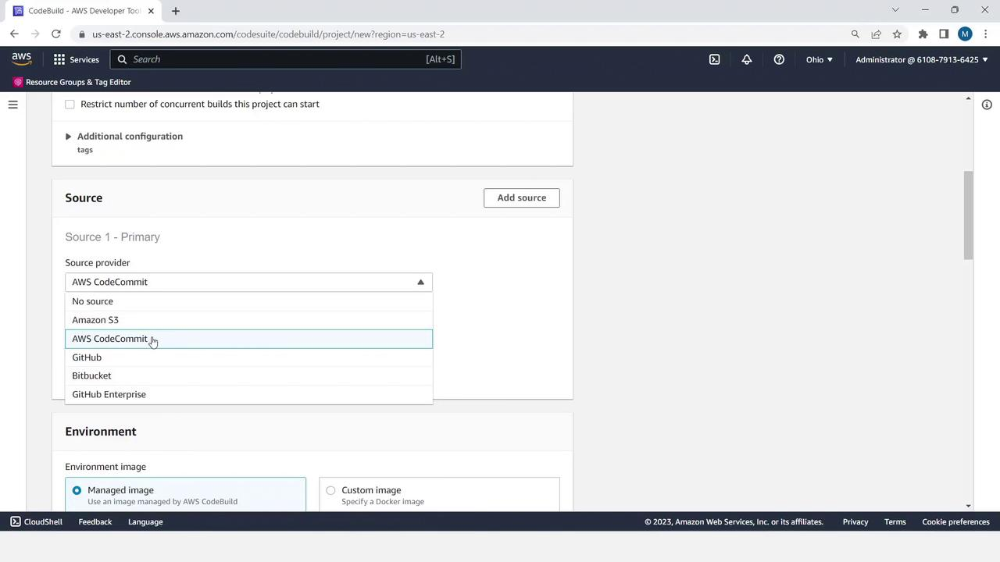
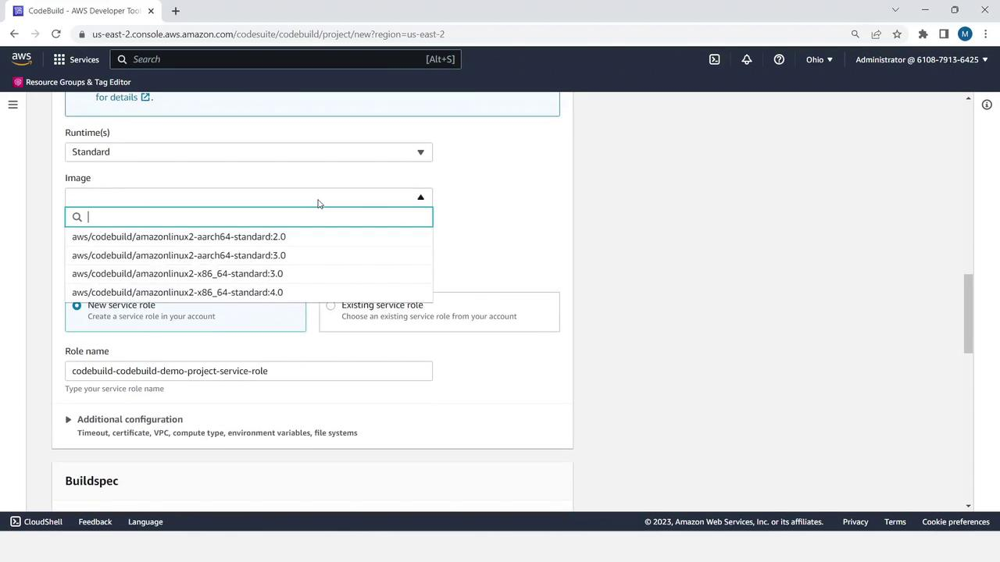
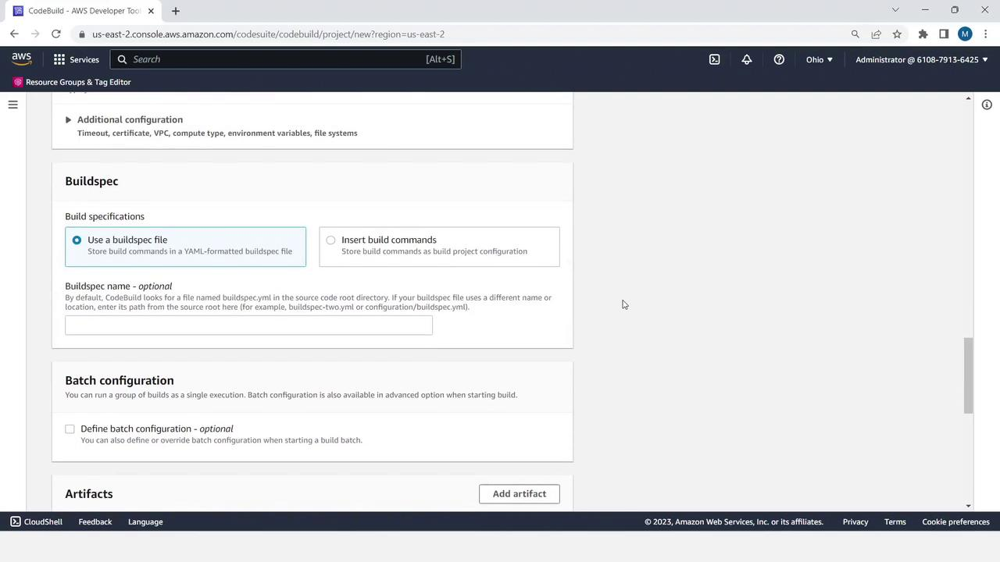
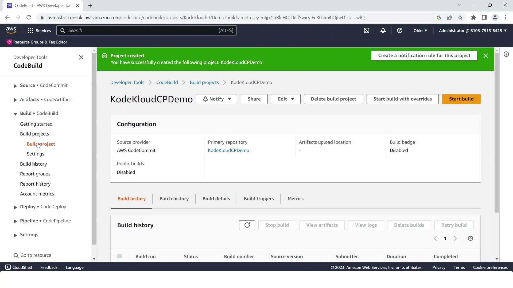
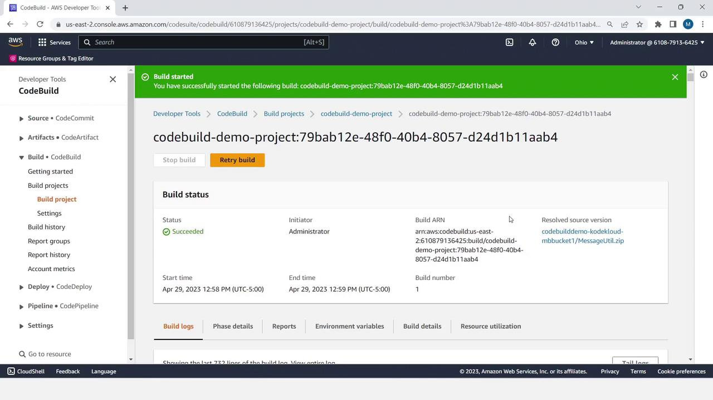
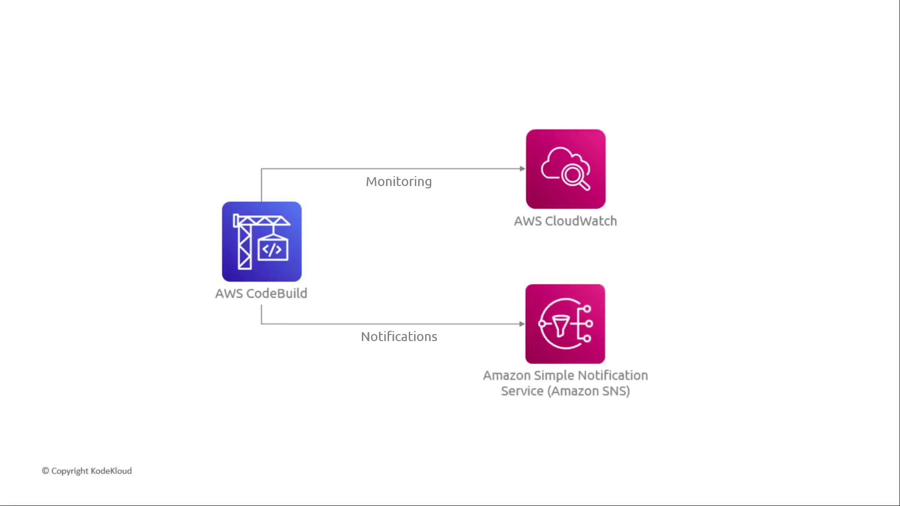

# 03 — CodeBuild demo (console walkthrough)

**Learning objectives**

- Create a CodeBuild project in the AWS console
- Point it at a source and a `buildspec.yml`
- Read phase logs until the build is **Succeeded**

> Screenshots under [`../images/day-08-cicd/`](../images/day-08-cicd/) are from the [KodeKloud CodeBuild Demo](https://notes.kodekloud.com/docs/AWS-CodePipeline-CICD-Pipeline/CICD-Pipeline-with-CodeCommit-CodeBuild-and-CodeDeploy/CodeBuild-Demo/page). Their demo used S3 + a Java ZIP; **this course uses GitHub + [`sample-app/`](./sample-app/)** — same console clicks.

---

## What you're building

A one-shot CI job:

```text
GitHub (or S3 ZIP) ─▶ CodeBuild ─▶ artifacts + CloudWatch logs
```



---

## Step 1 — Source ready

1. Push [`sample-app/`](./sample-app/) to a GitHub repo (Lab 08A Part A), **or**
2. (KodeKloud style) zip the project and upload to an S3 bucket as the source object.

The buildspec at the repo root is what CodeBuild will execute:

```yaml
version: 0.2
phases:
  install:
    runtime-versions:
      nodejs: 20
  pre_build:
    commands:
      - test -f index.html && echo "index.html present"
  build:
    commands:
      - echo "Packaging the site"
artifacts:
  files:
    - index.html
    - appspec.yml
    - scripts/**/*
```

---

## Step 2 — Create the build project

1. Open **CodeBuild → Build projects → Create build project**.



2. **Name:** `class-build` (or any unique name).
3. **Source:** GitHub (connect account) → pick your repo and `main`  
   *(KodeKloud screenshots show Amazon S3 as the provider — same screen, different choice.)*



4. **Environment:** Managed image → Amazon Linux → Standard runtime. Let CodeBuild create a new service role.



5. **Buildspec:** Use a buildspec file (reads `buildspec.yml` from the source root).



6. Create the project, then **Start build**.



---

## Step 3 — Watch the phases

Open the running build → **Build logs**. You should see:

```text
DOWNLOAD_SOURCE → INSTALL → PRE_BUILD → BUILD → POST_BUILD → UPLOAD_ARTIFACTS
```

- `pre_build` prints **"index.html present"** when the quick test passes.
- Status ends **Succeeded** (green).



Logs and metrics also flow to **CloudWatch**; you can wire **SNS** for failure alerts.



---

## Break-the-build homework

Rename or delete `index.html` in the repo, push, and re-run. `pre_build` fails and the project goes red — then restore the file.

---

## Clean up 💸

If you're not continuing to Lab 08A/08B in the same account, delete the CodeBuild project (and any S3 source/artifact buckets you created for the KodeKloud-style path).

➡️ Hands-on: [Lab 08A — Build with CodeBuild](./Lab-08A-CodeBuild.md) · Next concept: [04 — CodePipeline demo](./04-CodePipeline-Demo.md)
