# 04 — CodePipeline demo (2-stage and 4-stage)

**Learning objectives**

- Create a pipeline in the console and watch stages go green
- Compare a **minimal** Source → Deploy flow with a **full** Source → Build → Test → Deploy flow
- Map KodeKloud's demos onto this course's **GitHub + S3** lab path

> Screenshots: [`../images/day-08-cicd/`](../images/day-08-cicd/) from [KodeKloud Demonstrations 1–3](https://notes.kodekloud.com/docs/AWS-CodePipeline-CICD-Pipeline/Creating-a-CICD-pipeline-with-AWS-CodePipeline/Demonstration-1-Create-2-Stage-Pipeline/page). KodeKloud used CodeCommit/S3 → CodeDeploy → EC2; **new accounts should use GitHub** (CodeCommit is closed) and Lab 08B uses **S3** as the cheap deploy target.

---

## Three pipeline shapes

| Demo | Stages | Source | Deploy |
| ---- | ------ | ------ | ------ |
| **1 — Minimal** | Source → Deploy | Versioned ZIP in **S3** | CodeDeploy → EC2 |
| **2 — Git source** | Source → Deploy | **Git** repo | CodeDeploy → EC2 |
| **3 — Full CI/CD** | Source → Build → Test → Deploy | Git + **CodeBuild** | CodeDeploy → EC2 |

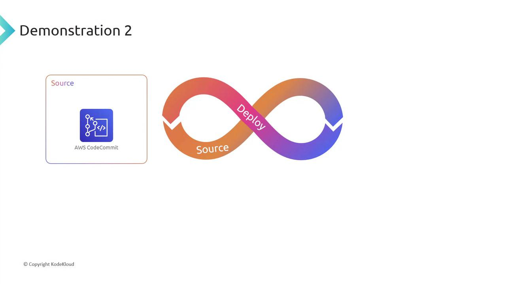

**This course's Lab 08B:** GitHub → CodeBuild → **S3 website** (same orchestration, no EC2 agent).

---

## Demo A — Create the pipeline (wizard)

1. **CodePipeline → Create pipeline** → *Build custom pipeline*.
2. Name it (e.g. `class-pipeline` / `MyFirstPipeline`). Create a new service role.

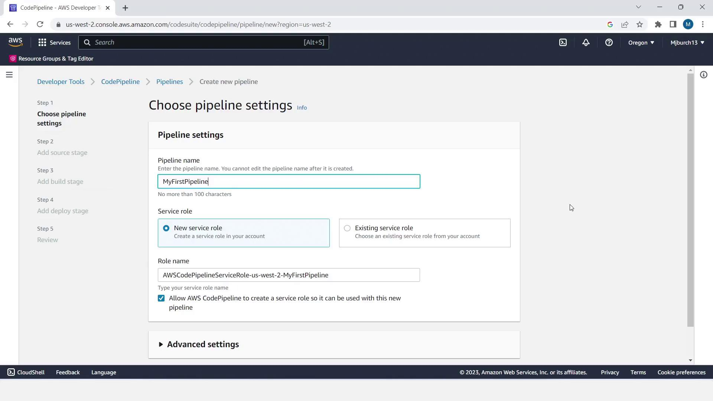

3. **Source stage**

| Course lab | KodeKloud Demo 1 | KodeKloud Demo 2/3 |
| ---------- | ---------------- | ------------------ |
| GitHub (v2) connection → repo `main` | Amazon S3 + object key (ZIP) | CodeCommit branch |

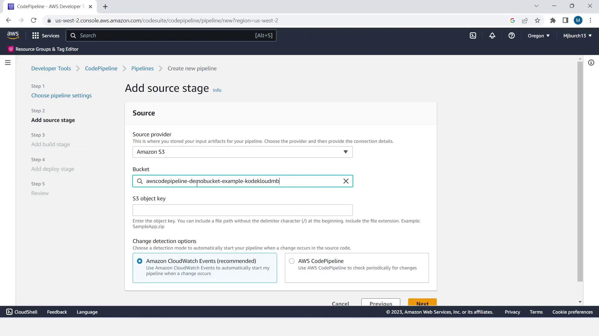

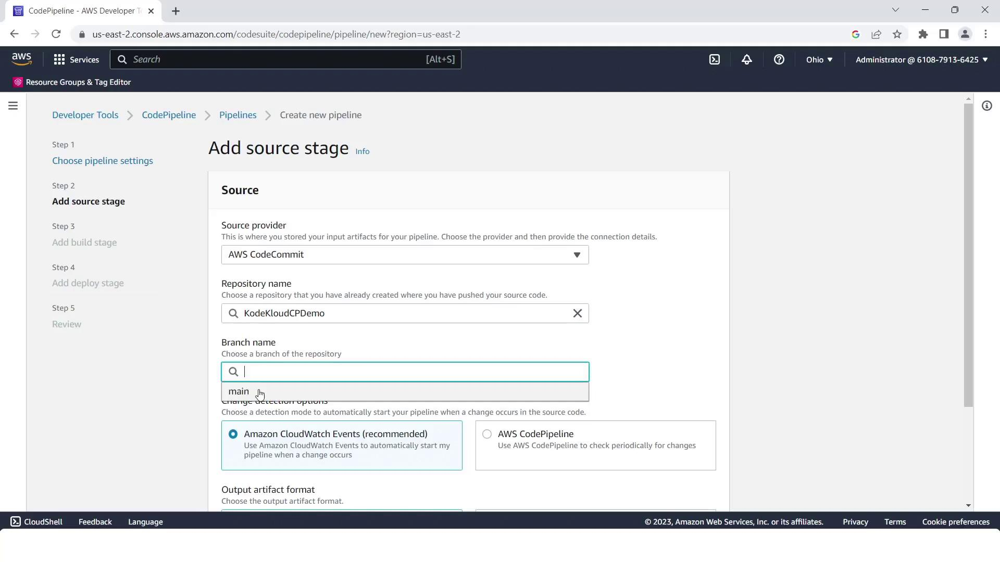

4. **Build stage**

- Lab / Demo 3: choose your **CodeBuild** project (`class-build`).
- Demo 1/2: you can **Skip** build if the artifact is already packaged.

5. **Deploy stage**

| Course lab | KodeKloud demos |
| ---------- | --------------- |
| **Amazon S3** → deploy bucket, **Extract file before deploy** | **CodeDeploy** → application + deployment group |

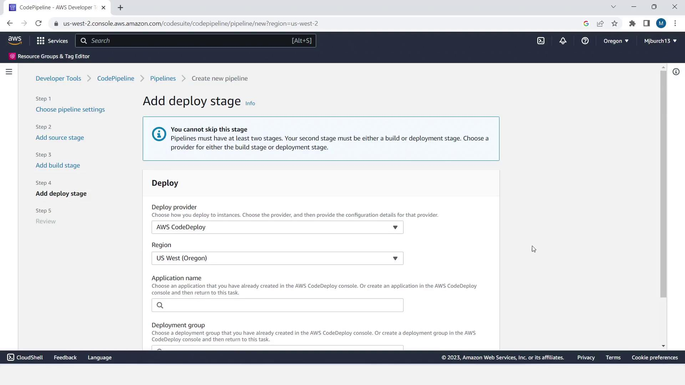

6. Create the pipeline — it runs immediately.

---

## Demo B — Two-stage success (Source → Deploy)

After Create, both stages turn green when CodeDeploy finishes on the tagged EC2 instances (KodeKloud path).

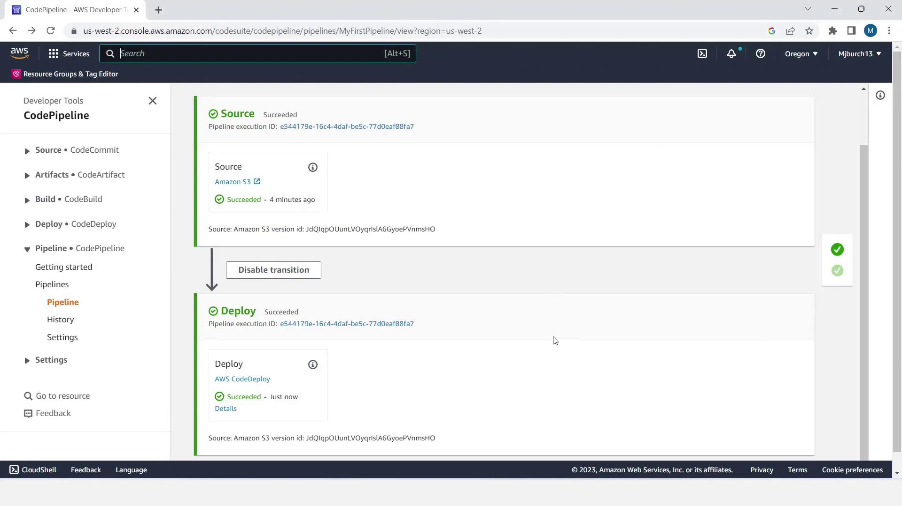

Validate by opening the instance public DNS (HTTP) or, in Lab 08B, the S3 website endpoint.

---

## Demo C — Four-stage pipeline (add Build + Test)

1. Create Source (Git) → Build (CodeBuild) → Deploy (CodeDeploy) first.

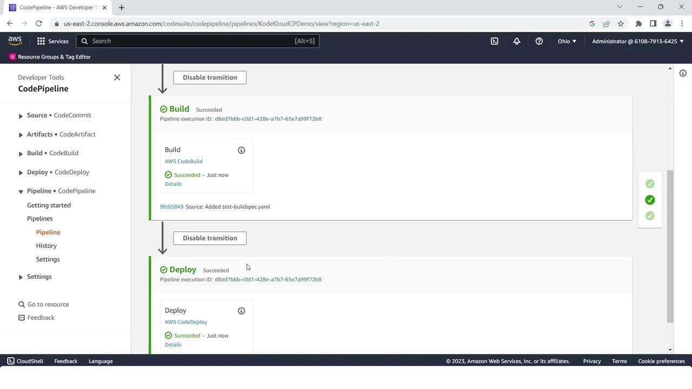

2. **Edit** the pipeline → **Add stage** between Build and Deploy → name it `Test`.
3. Add an action group: provider **CodeBuild**, input artifact from Build, same or a dedicated test project.

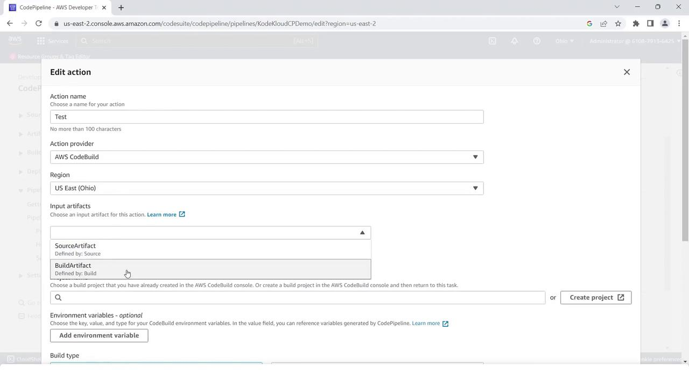

4. **Save** → **Release change**. All four stages should succeed.

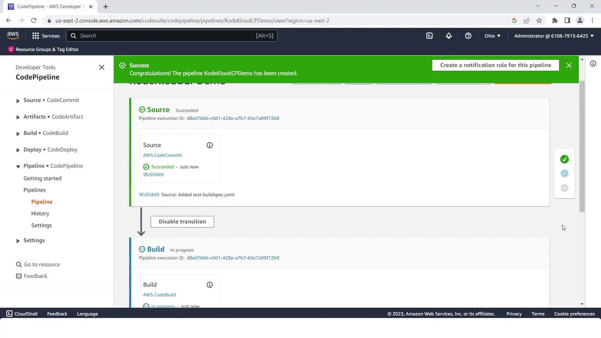

---

## CodeDeploy pieces (when targeting EC2)

If you follow the KodeKloud EC2 path instead of S3:

1. IAM instance profile with CodeDeploy + SSM permissions; CodeDeploy **service role**.
2. EC2 tagged for the deployment group (e.g. `Name=MyCodePipelineDemo`); agent installed.
3. **CodeDeploy → Applications → Create** (EC2/On-premises).

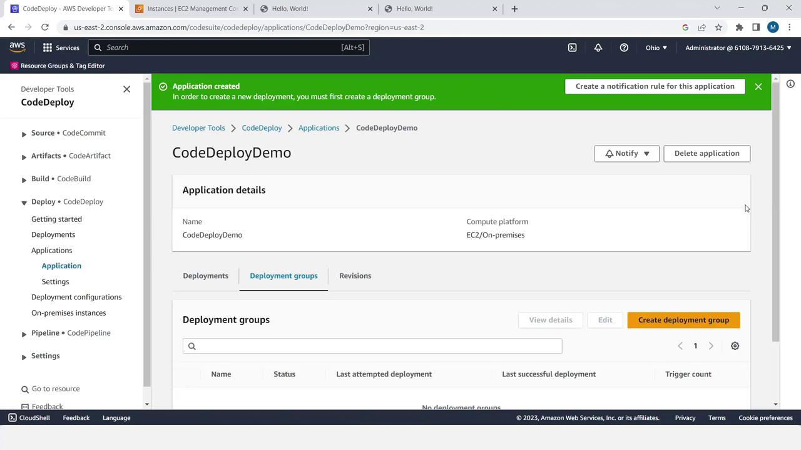

4. Deployment group → filter by EC2 tag; deployment config e.g. OneAtATime; no load balancer for the demo.

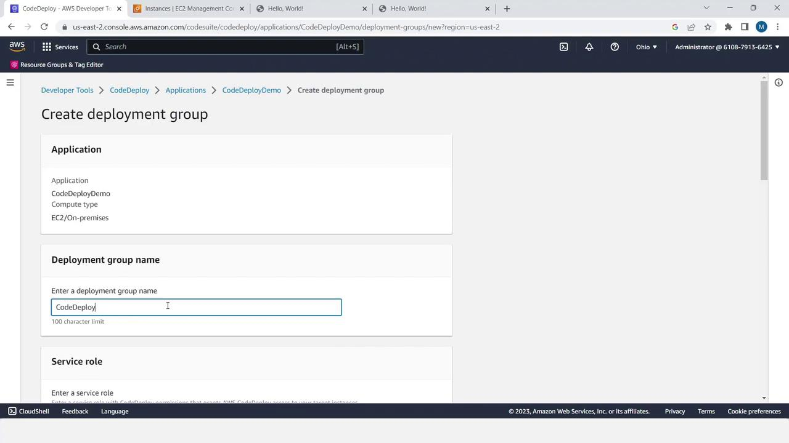

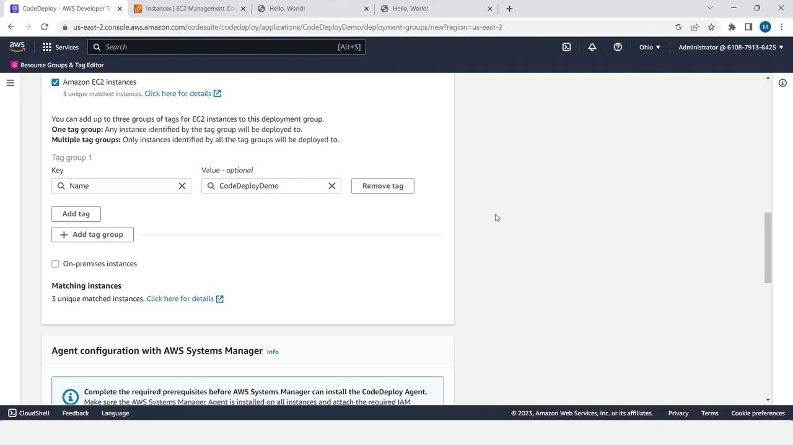

5. Pipeline Deploy stage points at that application + group. A successful revision looks like:

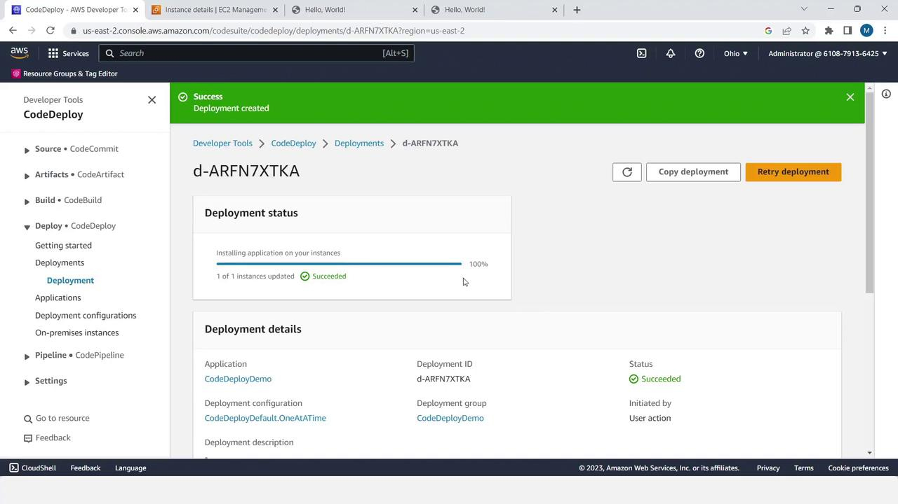

`appspec.yml` + hooks from [`sample-app/`](./sample-app/) tell the agent where to copy files and which scripts to run.

---

## Prove automation

1. Change `index.html` (heading text) and push to `main` (or upload a new ZIP version to S3).
2. The pipeline **re-runs by itself**.
3. Refresh the site — change is live with no manual deploy.

```text
git push ─▶ Source ✅ ─▶ Build ✅ ─▶ (Test ✅) ─▶ Deploy ✅ ─▶ live
```

---

## Clean up 💸

Delete the pipeline, CodeBuild project(s), CodeDeploy app/group, extra S3 buckets, and terminate demo EC2 instances.

➡️ Hands-on: [Lab 08B — A CodePipeline end to end](./Lab-08B-CodePipeline.md)
